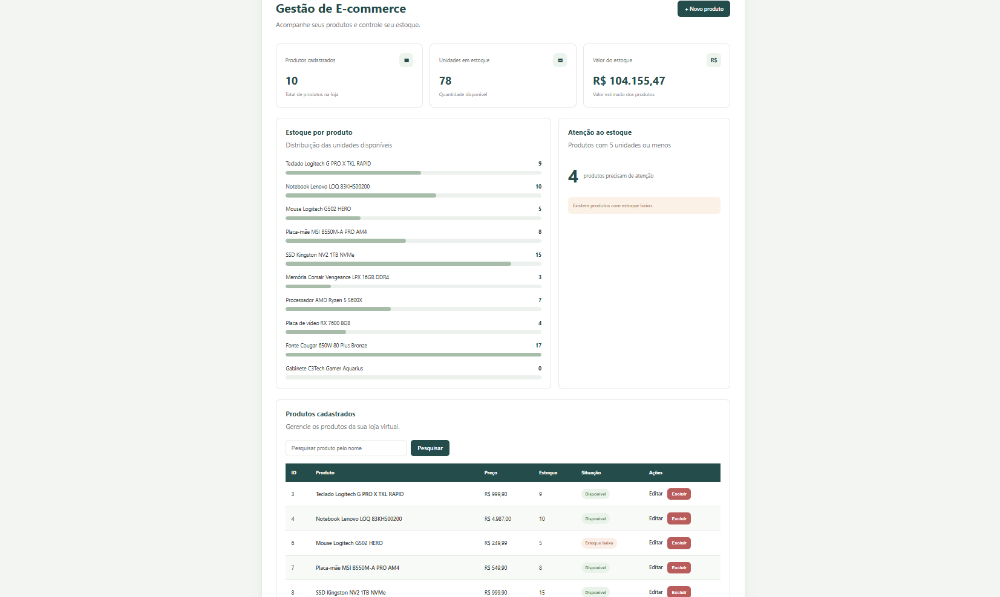
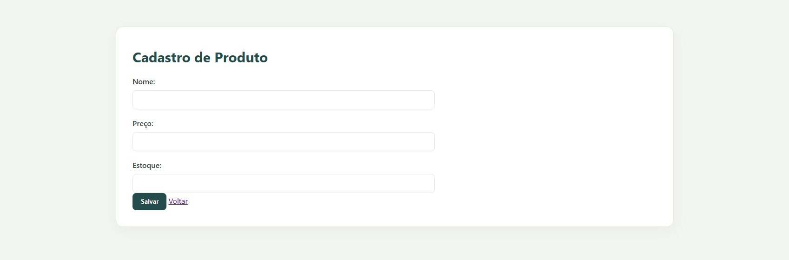

# Gestão de E-commerce

Sistema web para gerenciamento de produtos e controle de estoque de uma loja virtual, desenvolvido como atividade prática acadêmica da Universidade de Mogi das Cruzes (UMC).

O projeto utiliza Java 21, Spring Boot, Spring Data JPA e MySQL, com uma interface desenvolvida em HTML5, Thymeleaf e CSS3.

## Sobre o projeto

O sistema foi desenvolvido com o objetivo de facilitar o gerenciamento de produtos de um e-commerce, permitindo cadastrar, consultar, editar e excluir produtos, além de acompanhar preços e disponibilidade de estoque em uma interface organizada e intuitiva.

Além das operações de gerenciamento, o sistema possui um dashboard administrativo com indicadores e visualizações gráficas calculados a partir dos dados armazenados no banco de dados.

## Funcionalidades

### Gerenciamento de produtos (CRUD)

- Cadastro de produtos.
- Listagem de produtos.
- Pesquisa de produtos por nome.
- Edição de produtos cadastrados.
- Exclusão de produtos.
- Validação dos campos do formulário.

### Dashboard administrativo

- Indicador da quantidade de produtos cadastrados.
- Indicador do total de unidades disponíveis em estoque.
- Cálculo do valor estimado do estoque.
- Gráfico de distribuição de estoque por produto.
- Identificação de produtos com estoque baixo (5 unidades ou menos).
- Atualização dos indicadores conforme os dados armazenados no MySQL.

## Tecnologias utilizadas

| Tecnologia | Aplicação |
|---|---|
| Java 21 | Linguagem de programação |
| Spring Boot | Estrutura da aplicação |
| Spring MVC | Controle das rotas |
| Spring Data JPA | Persistência dos dados |
| Hibernate | Mapeamento objeto-relacional |
| Thymeleaf | Integração entre Java e HTML |
| MySQL | Banco de dados |
| HTML5 | Estrutura das páginas |
| CSS3 | Estilização da interface |
| Maven | Gerenciamento de dependências |
| Git e GitHub | Versionamento do projeto |

## Estrutura do projeto

```text
gestao/
├── docs/
│   └── screenshots/
│       ├── dashboard.png
│       └── formulario.png
├── src/
│   ├── main/
│   │   ├── java/
│   │   │   └── com/ecommerce/gestao/
│   │   │       ├── controller/
│   │   │       ├── entity/
│   │   │       ├── repository/
│   │   │       ├── service/
│   │   │       └── GestaoApplication.java
│   │   └── resources/
│   │       ├── static/
│   │       │   └── css/
│   │       │       └── style.css
│   │       ├── templates/
│   │       │   └── produtos/
│   │       │       ├── listar.html
│   │       │       └── formulario.html
│   │       └── application.properties
│   └── test/
├── pom.xml
├── mvnw
├── mvnw.cmd
└── README.md
```

## Demonstração visual

### Dashboard administrativo

Painel de controle com indicadores de produtos cadastrados, unidades disponíveis, valor estimado do estoque, gráfico de distribuição e alertas de produtos com estoque baixo.



### Cadastro de produtos

Interface utilizada para cadastrar e editar produtos, com campos para nome, preço e quantidade em estoque.



## Como executar o projeto

### 1. Pré-requisitos

- Java JDK 21.
- MySQL.
- XAMPP.
- IntelliJ IDEA ou outra IDE compatível.

### 2. Configuração do banco de dados

1. Inicie o serviço MySQL pelo XAMPP.
2. Acesse o phpMyAdmin.
3. Crie o banco de dados `gestao_ecommerce`, caso ainda não exista.
4. Abra o arquivo `application.properties`.
5. Confira e configure os dados de conexão com o MySQL.

**Importante:** as credenciais de acesso ao banco devem ser configuradas localmente e não devem ser publicadas no repositório.

### 3. Executar a aplicação

Abra o terminal na pasta principal do projeto e execute o comando:

**Windows (PowerShell):**

```powershell
.\mvnw.cmd spring-boot:run
```

Aguarde a inicialização do Spring Boot.

### 4. Acessar o sistema

Após a inicialização da aplicação, abra o navegador e acesse:

http://localhost:8080/produtos

## Dashboard e controle de estoque

O dashboard apresenta informações calculadas a partir dos produtos armazenados no banco de dados.

O valor estimado do estoque é calculado pela multiplicação do preço de cada produto pela respectiva quantidade disponível.

Produtos com estoque igual ou inferior a 5 unidades são identificados como estoque baixo, permitindo acompanhar os itens que precisam de reposição.

Os indicadores são atualizados conforme os registros armazenados no MySQL.

## Banco de dados

O sistema utiliza MySQL para armazenar as informações dos produtos cadastrados.

A persistência dos dados é realizada por meio do Spring Data JPA e Hibernate, permitindo a integração entre as entidades Java e as tabelas do banco de dados.

## Versionamento

O projeto utiliza Git e GitHub para controle de versão e acompanhamento da evolução do desenvolvimento.

**Repositório oficial:**

https://github.com/GuilhermeSouza0/gestao-ecommerce

## Projeto acadêmico

**Instituição:** Universidade de Mogi das Cruzes (UMC)

**Projeto:** Sistema de Gestão de E-commerce

**Objetivo:** Aplicar conhecimentos de desenvolvimento web utilizando Spring Boot, Spring MVC, Thymeleaf, Spring Data JPA e MySQL na construção de um sistema CRUD completo.

---

Desenvolvido como atividade prática acadêmica.